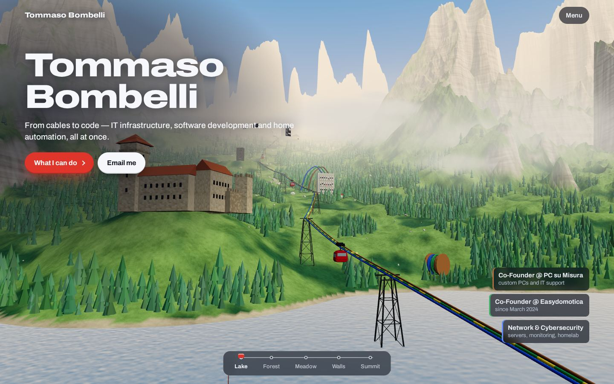
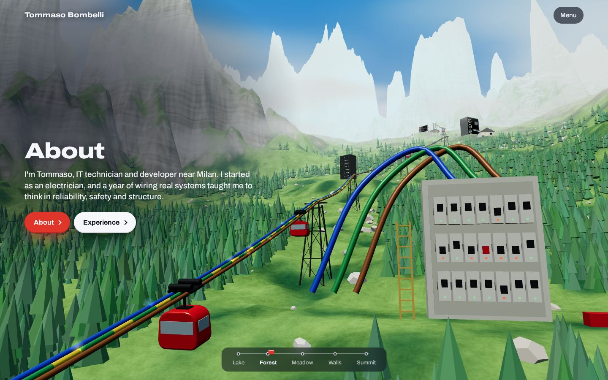
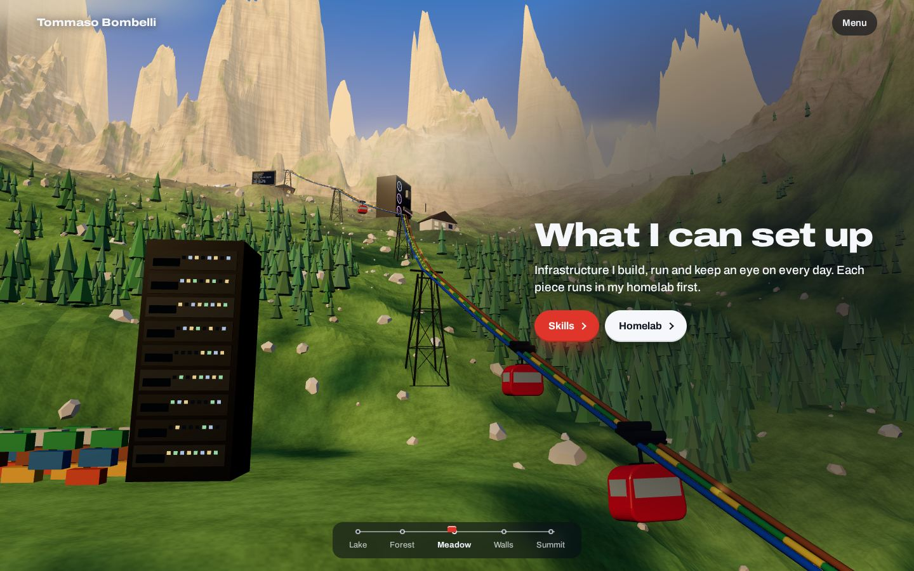
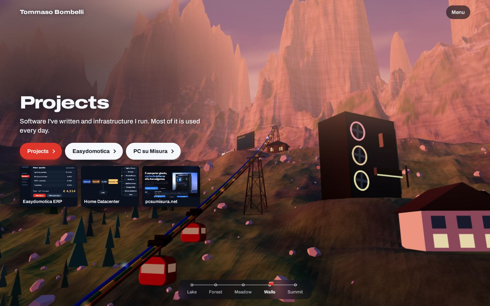
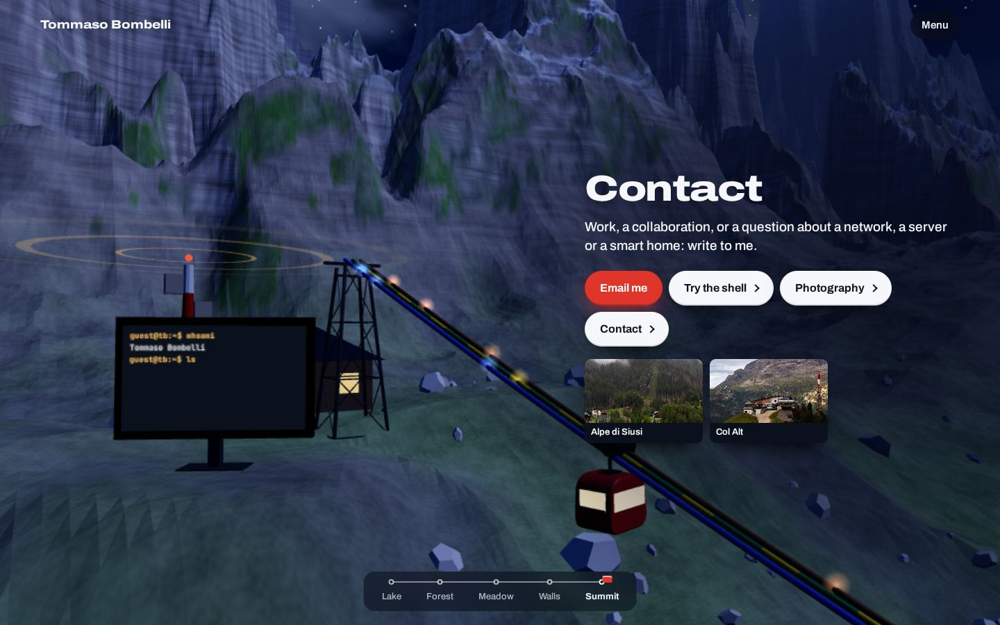
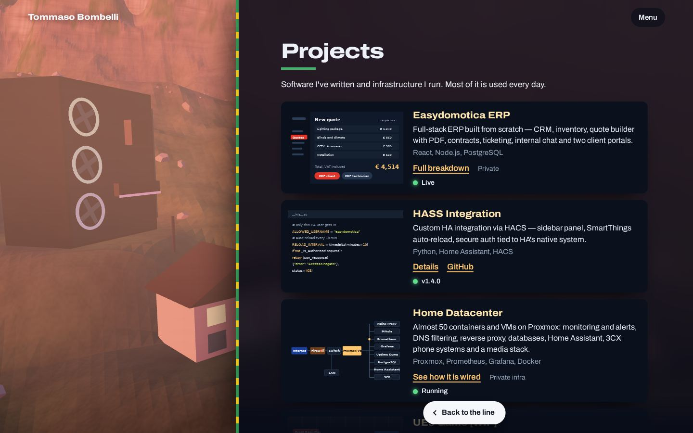

# Tommaso Bombelli

**[tommasobombelli.com](https://tommasobombelli.com)**: my personal site, built as a cable-car ride you can scroll through.

I started as an electrician, and now I work in IT and write software. So the three conductors from my first job (brown, blue and yellow-green) became the cables of a cable car, climbing from Lake Maggiore, where I live, to the Dolomites I like to photograph. From cables to code.

[](https://tommasobombelli.com)

## The ride

Five stops, one scroll each. The light changes from morning to night, and each stop has something from my work standing on the ground. You can click it to open its page.

| | Stop | What stands there | Opens |
|---|---|---|---|
|  | **Forest** | The distribution board, where it all started | About, Experience |
|  | **Meadow** | A server rack and 49 containers, for my homelab | Skills, Homelab |
|  | **Walls** | A smart home and a giant custom PC, for my two companies | Projects, Easydomotica, PC su Misura |
|  | **Summit** | A radio mast, a screen running the shell, my photos on a line | Contact, Shell, Photography |

The first stop, **Lake**, has a model of the Rocca di Angera, which opens About, and a cable drum, which opens Skills.

Each page slides in beside the world, and the camera flies to the object it talks about:

[](https://tommasobombelli.com/#projects)

## Try these

- **[The shell](https://tommasobombelli.com/#shell-sec)**: a small command line that knows everything on the site. Start with `help`, then try `neofetch`, `nmap` or `cat .secrets`.
- **[The homelab map](https://tommasobombelli.com/#lab)**: how my Proxmox server is wired, with moving traffic. The traffic and the log are simulated, and the page says so.
- **`theme dark`** in the shell: skips straight to night.

## How it is built

Handwritten HTML, CSS and JavaScript, with no framework and no build step. GitHub Pages serves these files exactly as they are.

- **The world** is generated in the browser when the page loads, by code in `world.js`, using [three.js](https://threejs.org). The terrain, trees, castle and cable car are not model files.
- **The stone** is drawn by a shader, so the walls catch the light of each hour. They turn pink at sunset, like the Dolomites do.
- **The texts** live in `content.json` and `index.html`, and `site.js` puts them on the page.
- **Without WebGL**, or with reduced motion turned on, the site still works and all the content stays readable.

| File | What it does |
|---|---|
| `index.html` | The five stops and every page |
| `world.js` | The 3D world and the ride |
| `site.js` | Opens the pages, renders `content.json` |
| `lab.js` | Homelab map, shell, latest repositories |
| `style.css` | All the styling |
| `content.json` | Experience, projects, skills, photos |
| `vendor/` | three.js, trimmed to what the site uses |

## Run it locally

It needs a local server, because the browser won't load `content.json` from a file opened directly:

```
git clone https://github.com/Tommaso-Bombelli/Tommaso-Bombelli.github.io
cd Tommaso-Bombelli.github.io
python3 -m http.server 8765
```

Then open <http://localhost:8765>.

## Credits

- [three.js](https://threejs.org), MIT licence (`vendor/three.LICENSE`)
- Photo of the Rocca di Angera by [Monster4711](https://commons.wikimedia.org/w/index.php?curid=175029400), CC0, via Wikimedia Commons
- Type: [Archivo](https://fonts.google.com/specimen/Archivo) and [JetBrains Mono](https://fonts.google.com/specimen/JetBrains+Mono)
- The other photographs on the site are mine

## Contact

Work, a collaboration, or a question about a network, a server or a smart home: [tommaso.bombelli03@gmail.com](mailto:tommaso.bombelli03@gmail.com) or [LinkedIn](https://www.linkedin.com/in/tommaso-bombelli-204723286).
